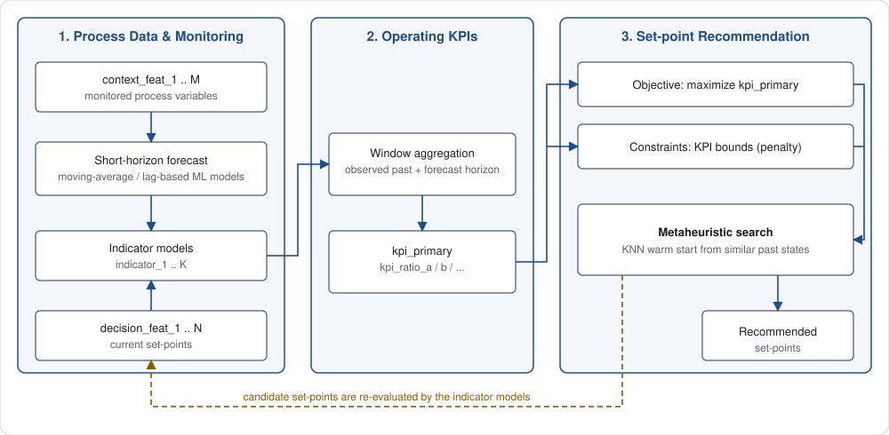

# Continuous-Process Anomaly Detection & Operating-Condition Optimization

An industry–academia project on a continuous process: monitoring the process state with ML models and recommending better operating set-points with a metaheuristic optimizer.

> **Disclosure** — This repository is an overview only. It contains no source code, data, trained models, or real variable names. Variables are shown as generic placeholders (`decision_feat_N` for controllable set-points, `context_feat_N` for monitored variables).

## Problem

- The process has many **decision variables** that operators set directly, and many **context variables** that are only monitored.
- Operating performance is judged by **KPIs** aggregated over a time window from several process indicators.
- Goal: find set-points that **maximize a primary KPI while keeping the other KPIs within their bounds**.

## Pipeline

  

1. **Monitoring & anomaly detection** — monitored variables are forecast over a short horizon, and ML indicator models turn (context + decision) variables into process indicators.
2. **Operating KPIs** — observed history and the forecast horizon are combined and aggregated over the KPI window.
3. **Operating-condition optimization** — a metaheuristic searches the decision variables to maximize the primary KPI, with KPI bounds handled as penalties. The result is fed back through the indicator models and finally returned as recommended set-points.

## My contributions

### ML model development
- Built multivariate forecasting models for process indicators that are measured offline and therefore only sparsely labeled, while the process signals themselves are dense.
- Addressed label scarcity with a semi-supervised scheme: a confidence-filtered, current-state model supplies extra training targets for the longer-horizon forecaster.
- Compared several modeling approaches for the forecasting task.

### Optimization algorithm design
- Formulated the set-point search as a constrained optimization problem on top of the ML models (objective, KPI constraints, decision-variable bounds).
- Chose **Particle Swarm Optimization**: all decision variables are continuous, which suits PSO's velocity-based update better than discrete-oriented methods such as GA.
- Designed a **KNN warm start**: the swarm is initialized with the best-performing set-points found among past process states most similar to the current one, so the search starts in a realistic, well-supported region.
- Handled constraints with a relative-violation penalty, velocity clamping, and a small mutation rate to avoid premature convergence.
- Also explored a **surrogate-assisted** alternative: distilling the indicator models into quadratic surrogates, conditioning them on the current process state, and solving the reduced problem with gradient-based optimization.

## Related

- Algorithm implementations and surrogate-assisted optimization (PSO / GA / Tabu Search / Simulated Annealing / quadratic-surrogate NLP) on a synthetic problem: see the `optbench` repository.
